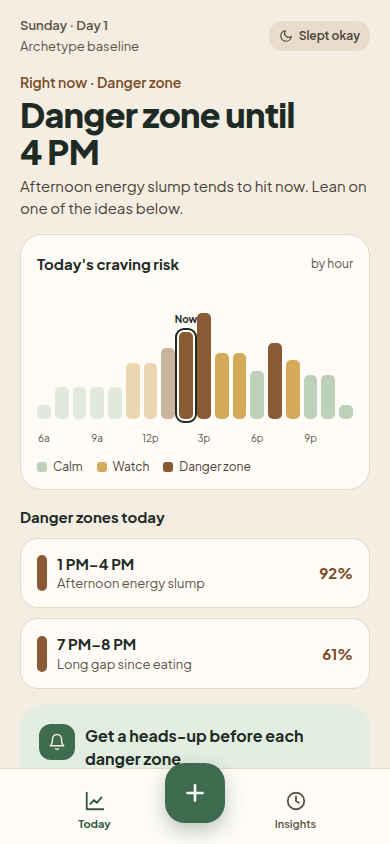
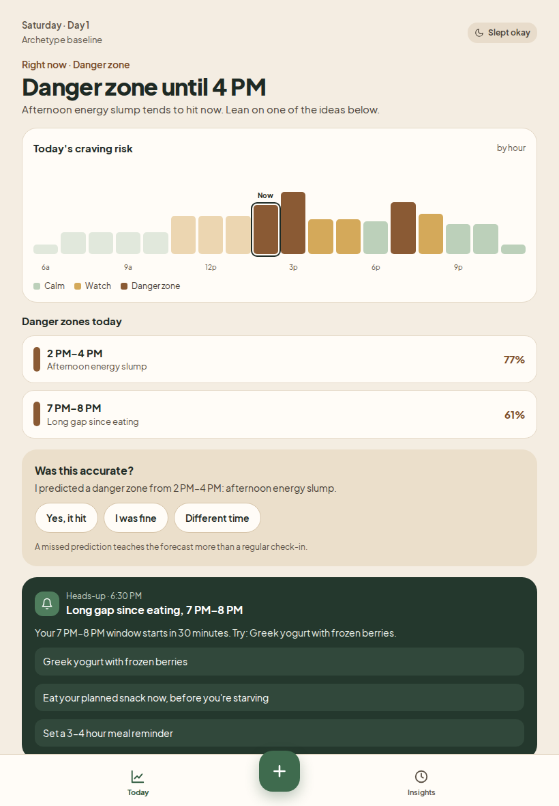
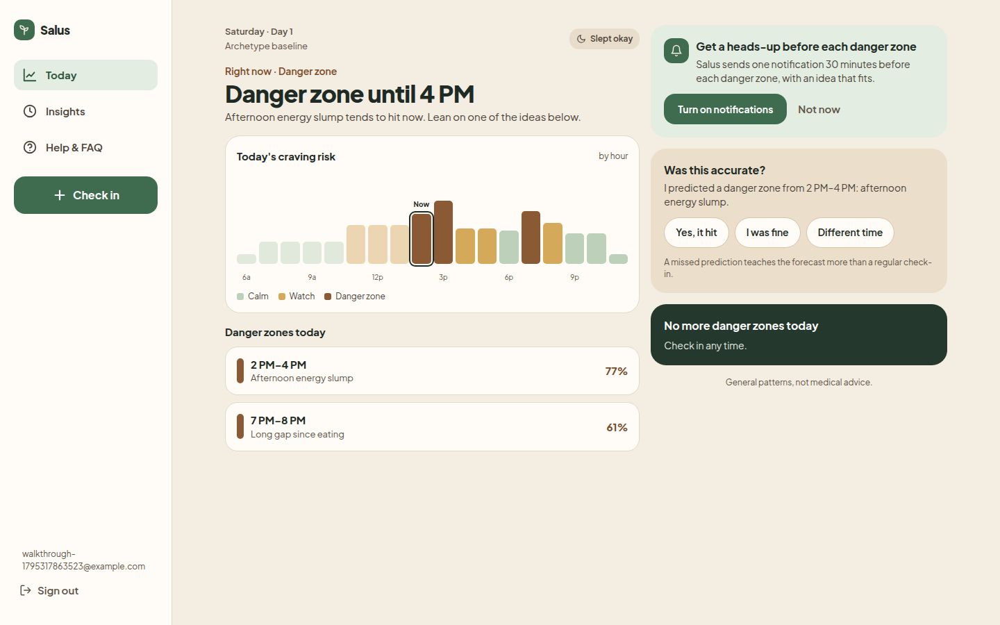
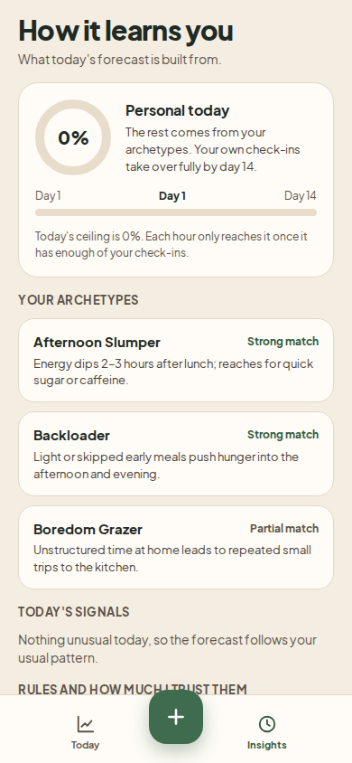
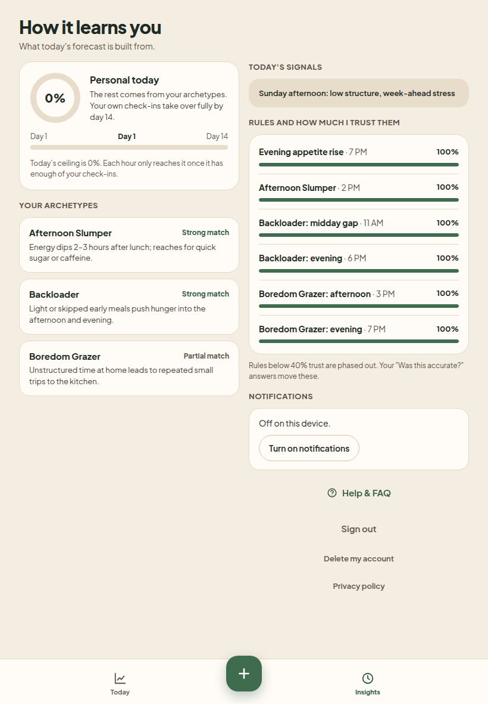
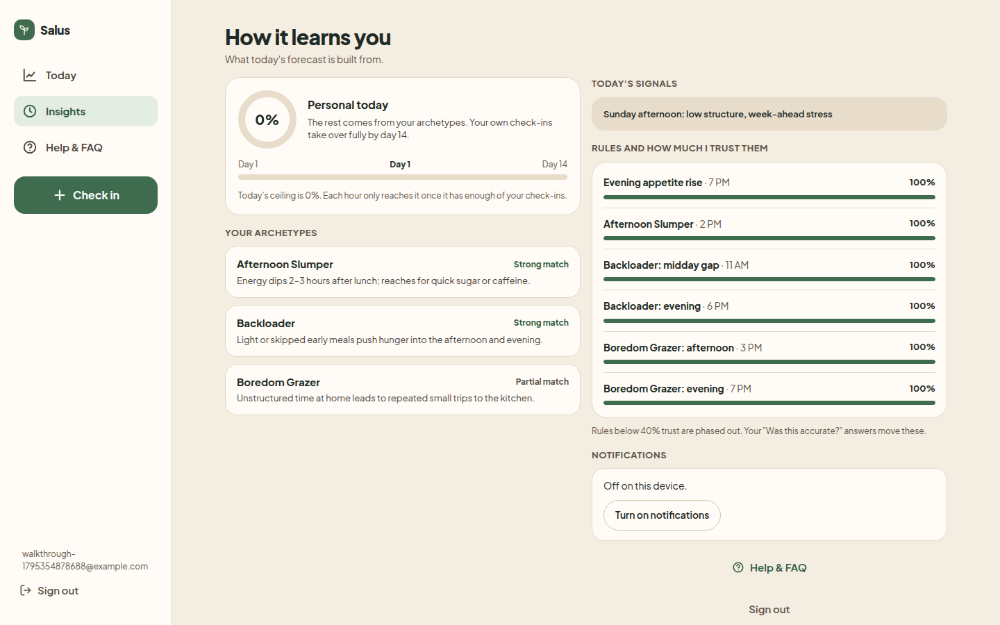

# Salus

[](https://github.com/tmburbeck/craving-forecast/actions/workflows/ci.yml)

A satiety and craving pattern predictor, named for the Roman goddess of health and well-being. (The code still uses the `CravingForecast` working name.) Instead of logging food, users rate their hunger or craving (1–10) and tag the context. The app learns their personal "danger zones" and sends a nudge 30 minutes before each one, matched to the trigger: a high-volume, high-protein snack or a quick distraction.

**Use it:** https://salus-tmburbeck-bafcfcg0exfpduh6.westus3-01.azurewebsites.net works on phones, iPads and computers. On an iPhone, open it in Safari and choose **Share → Add to Home Screen** to use it like an app.

## Screens

Taken automatically by the web walk-through in CI on every merge to `main`; pull requests get their own set as a comment.

| Phone | iPad | Desktop |
| --- | --- | --- |
|  |  |  |
|  |  |  |

## How the prediction works

| Layer | When it leads | What it does |
|---|---|---|
| **1. Archetypes** | Day 1 | A 9-question, ~60 second quiz scores six rule-based archetypes (Afternoon Slumper, Revenge Bedtime Snacker, Post-Work Decompressor, Backloader, Boredom Grazer, Weekend Drifter). Each one adds risk windows based on the user's own wake time, bedtime and shift. |
| **2. Daily context** | Days 2–7 | Passive signals adjust each day: sleep (HealthKit or a one-tap morning question), steps, back-to-back meetings from the calendar, plus Friday-evening and Sunday-afternoon rules. Poor sleep raises risk across the whole day (higher ghrelin, lower leptin). |
| **3. Bayesian personalization** | Day 7 onward | Each hour blends baseline and personal data: `risk = (1 − w) · baseline + w · personal`, where `w = ceiling(day) × n / (n + 2)`. The ceiling is 0% on day 1, 50% on day 7 and 100% on day 14. The `n / (n + 2)` term is confidence weighting: an hour only moves to personal data once it has enough check-ins. |

**"Was this accurate?" loop.** After each window, the user confirms or corrects the prediction. Every rule covering that window has a trust score, modeled as Beta(3 + accurate, 1 + 1.5 × missed). Misses count more because they carry more information. A rule whose trust drops below 40% is phased out. Answers also become weighted check-ins (×3 for a confirmed or relocated craving, ×2 for a miss), so the personal layer learns faster than it would from routine check-ins alone.

## Projects

```
src/CravingForecast.Core     Pure engine: archetypes, context signals, blending, zones, nudges, feedback. No dependencies.
src/CravingForecast.Api      ASP.NET Core minimal API: email/password accounts, SQLite via EF Core. Also serves the web app.
src/CravingForecast.Web      Blazor WebAssembly web app for phone, iPad and desktop (installable to the home screen).
src/CravingForecast.Mobile   .NET MAUI app (iOS, Android, Windows): splash, welcome, quiz, Today/Insights tabs, check-ins,
                             HealthKit, calendar, scheduled nudges.
tests/CravingForecast.Tests  xUnit tests for the engine, presentation rules and API.
tests/e2e                    Playwright walk-through of the web app; also takes the screenshots.
```

## Run it

Requires the .NET 10 SDK (pinned in `global.json`).

```bash
dotnet test tests/CravingForecast.Tests
cd src/CravingForecast.Api && dotnet run           # API and web app at http://localhost:5077
```

Open http://localhost:5077 for the web app, or `CravingForecast.Api.http` in Rider, Visual Studio or VS Code (REST Client extension) to call the API directly.

To run the browser walk-through against it (from `tests/e2e`, with Node 22): `npm ci`, `npx playwright install chromium`, then `node walkthrough.mjs http://localhost:5077 shots`.

### Mobile

```bash
dotnet workload install maui
dotnet build src/CravingForecast.Mobile -f net10.0-android    # emulator calls the API at 10.0.2.2:5077
```

- **iOS** needs a Mac with Xcode, plus an Apple developer account for the HealthKit entitlement.
- **The app talks to the hosted API** on Azure by default. To use an API running on your own computer instead, set `SALUS_API_URL` before starting the app (PowerShell: `$env:SALUS_API_URL = "http://localhost:5077/"`). An Android emulator reaches your computer at `http://10.0.2.2:5077/`; a USB phone uses `http://localhost:5077/` after `adb reverse tcp:5077 tcp:5077`.

## Endpoints

Everything under `/api/me` needs a signed-in user (the apps send `Authorization: Bearer <accessToken>`; the web app uses the `salus.auth` cookie from `/api/auth/login?useCookies=true`) and only ever touches that user's data.

| Method | Path | Purpose |
|---|---|---|
| POST | `/api/auth/register` | Create an account (email + password of 10+ characters) |
| POST | `/api/auth/login` | Sign in → `accessToken` (1 hour) + `refreshToken` |
| POST | `/api/auth/refresh` | Swap a refresh token for new tokens |
| POST | `/api/auth/logout` | End a web (cookie) session |
| GET | `/api/me` | Signed-in email, and whether the quiz is done |
| POST | `/api/me/profile` | Onboarding quiz → day-1 forecast (once per account) |
| GET | `/api/me/forecast?date=` | Hourly risk, zones, archetypes, factors, rule trust, next nudge |
| PUT | `/api/me/context/{date}` | Sleep / meetings / activity (only fields you send change) |
| POST | `/api/me/checkins` | 1–10 rating with optional context tags |
| GET | `/api/me/feedback/pending` | Today's finished zones not yet rated |
| POST | `/api/me/feedback` | `Accurate`, `Missed`, or `DifferentTime` + `actualHour` |
| GET | `/api/me/nudges?days=2` | Upcoming nudges for the phone to schedule |

## Design notes

- **Nudges reach the web app as Web Push notifications.** The API keeps each device's subscription and, once a minute, pushes nudges that are due (catching up on any missed in the last 20 minutes, each sent once). It uses the current standard (RFC 8291 `aes128gcm`, RFC 8292 VAPID), which Apple requires; on iPhone and iPad, notifications work once Salus is added to the Home Screen (iOS 16.4+). The VAPID keys are made on first use and stored in the database. On Azure's free plan the app visits its own address every 10 minutes (`Push:KeepAwakeUrl`) so it doesn't sleep through a nudge; a paid plan with Always On makes that unnecessary.
- **In the MAUI app, nudges are local notifications** scheduled on the device from `/nudges`, so they fire when the app is closed and no APNs or FCM server is needed. The app reschedules after each sync, check-in or feedback answer. iOS allows 64 pending notifications per app, which is plenty for 2 days.
- **Health data stays coarse.** The phone sends only `Poor / Ok / Good` and `Low / Normal / High`, never raw sleep or step counts. Calendar event details never leave the device; only a back-to-back yes/no is sent.
- **Health Connect (Android)** is stubbed. Android users get the morning sleep tap instead. See `HealthConnectSignals.cs` for wiring it up.
- **Accounts** use ASP.NET Core Identity: passwords of 10+ characters, lockout after 5 failed attempts, and 10 sign-in requests a minute per address. Token keys are kept in the database, so a restart doesn't sign anyone out.
- **Storage** is one SQLite file (`ConnectionStrings:Salus`, default `salus.db`) holding accounts and each user's forecast state as JSON. Schema changes go through EF Core migrations, applied at startup. Moving to Postgres means swapping the EF provider.

## Next steps

- [x] EF Core persistence + accounts
- [x] Hosting (Azure App Service, free tier) with HTTPS, deployed from CI on every push to `main`
- [ ] Health Connect implementation
- [ ] Weekday vs weekend personal patterns (personal estimates are currently by hour of day only)
- [ ] Tune context factors per user the same way rule trust is tuned

Baseline rules describe general patterns and are not medical advice.
